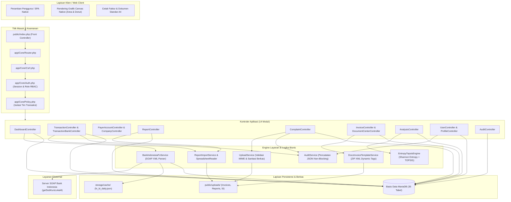

# Fable RemitOps — Sistem Operasional Remitansi & Analisis Multi-Kriteria

Aplikasi operasional remitansi perbankan berbasis PHP 8 dan MariaDB untuk pemrosesan transaksi, rekonsiliasi laporan harian, penagihan, standing instruction 7 bank nasional, serta sistem pendukung keputusan metode Entropy–TOPSIS.

---

## Panduan Menjalankan Sistem

### Persyaratan
* PHP 8.1 atau lebih baru
* Ekstensi PHP aktif: `pdo_mysql`, `curl`, `zip`, `dom`, `simplexml`, `bcmath`, `fileinfo`
* MariaDB 10.4+ atau MySQL 8.0+

### Langkah Instalasi

1. **Siapkan Database**
   Buat database baru bernama `AplikasiRemmitance` dan impor file database:
   ```bash
   mysql -u root -p -e "CREATE DATABASE IF NOT EXISTS AplikasiRemmitance CHARACTER SET utf8mb4 COLLATE utf8mb4_unicode_ci;"
   mysql -u root -p AplikasiRemmitance < aplikasiremmitance.sql
   ```

2. **Atur Variabel Lingkungan**
   Salin berkas contoh konfigurasi:
   ```bash
   cp .env.example .env
   ```
   Sesuaikan parameter koneksi pada `.env`:
   ```ini
   APP_NAME="Fable RemitOps"
   APP_ENV=local
   APP_DEBUG=true
   APP_URL=http://127.0.0.1:8000
   APP_TIMEZONE=Asia/Jakarta

   DB_HOST=127.0.0.1
   DB_PORT=3306
   DB_DATABASE=AplikasiRemmitance
   DB_USERNAME=root
   DB_PASSWORD=
   ```

3. **Jalankan Server Lokal**
   Gunakan router bawaan yang menyajikan aset publik dan fallback penulisan URL:
   ```bash
   php -S 127.0.0.1:8000 -t public public/router.php
   ```
   Akses aplikasi melalui peramban di `http://127.0.0.1:8000`.

### Kredensial Akun Default

| Peran | Username | Password Default | Cakupan Akses |
|---|---|---|---|
| Super Admin | `superadmin` | `Password123!` | Akses penuh seluruh modul dan konfigurasi sistem |
| Supervisor | `supervisor` | `Password123!` | Monitoring transaksi lintas tim, audit log, persetujuan |
| Admin Transaksi Tim 1 | `transaksi1` | `Password123!` | Input dan eksekusi transaksi khusus Tim 1 |
| Admin Transaksi Tim 2 | `transaksi2` | `Password123!` | Input dan eksekusi transaksi khusus Tim 2 |
| Admin Transaksi Tim 3 | `transaksi3` | `Password123!` | Input dan eksekusi transaksi khusus Tim 3 |
| Admin Transaksi Tim 4 | `transaksi4` | `Password123!` | Input dan eksekusi transaksi khusus Tim 4 |
| Admin Complain | `complain` | `Password123!` | Investigasi dan penyelesaian tiket komplain remitansi |
| Admin Invoice | `invoice` | `Password123!` | Pembuatan, pengiriman, dan pencetakan faktur tagihan |

---

## Skema Komprehensif Sistem & Basis Data

Bagian ini memuat arsitektur sistem berlapis, diagram relasi entitas (*Entity-Relationship Diagram* / ERD), serta katalog komprehensif 35 tabel basis data yang mendukung operasional remitansi.

### 1. Skema Arsitektur Sistem (Hexagonal / Multi-Tier)



---

### 2. Diagram Relasi Entitas (Entity-Relationship Diagram / ERD)

```mermaid
erDiagram
    roles ||--o{ users : "assigns"
    users ||--o{ audit_logs : "logs"
    users ||--o{ companies : "registers"
    companies ||--o{ payer_accounts : "owns"
    companies ||--o{ transactions : "orders"
    companies ||--o{ invoices : "billed"
    transactions ||--o{ invoices : "references"
    transactions ||--o{ complaints : "disputed"
    report_batches ||--o{ report_rows : "contains"
    report_rows ||--o{ complaints : "escalates"
    complaints ||--o{ complaint_histories : "tracks"
    bni_transaction_batches ||--o{ bni_transaction_rows : "contains"
    si_templates ||--o{ si_documents : "formats"
    si_documents ||--o{ si_document_items : "details"
    document_template_types ||--o{ document_templates : "categorizes"
    spk_sources ||--o{ spk_records : "imports"
    spk_criteria ||--o{ spk_subcriteria : "splits"
    spk_criteria ||--o{ spk_assessments : "weights"
    spk_alternatives ||--o{ spk_assessments : "evaluated"
    spk_runs ||--o{ spk_weights : "produces"
    spk_runs ||--o{ spk_results : "calculates"
    spk_alternatives ||--o{ spk_results : "ranks"

    roles {
        bigint id PK
        varchar code UK
        varchar name
    }
    users {
        bigint id PK
        bigint role_id FK
        varchar username UK
        varchar email UK
        tinyint transaction_team
        tinyint is_active
        tinyint must_change_password
    }
    companies {
        bigint id PK
        varchar code UK
        varchar name
        varchar status
        bigint created_by FK
    }
    payer_accounts {
        bigint id PK
        bigint company_id FK
        varchar account_no
        varchar bank_name
        char currency
        tinyint is_default
    }
    transactions {
        bigint id PK
        tinyint team_no
        bigint payer_company_id FK
        varchar beneficiary_name
        varchar beneficiary_account
        decimal amount
        char currency
        varchar swift
        varchar status
        char source_hash UK
    }
    report_batches {
        bigint id PK
        varchar name
        char month_key
        varchar client_name
        int total_rows
        int sent_rows
    }
    report_rows {
        bigint id PK
        bigint batch_id FK
        date transaction_date
        varchar bill_to
        decimal amount
        varchar delivery_status
        varchar result_status
    }
    complaints {
        bigint id PK
        varchar ticket_no UK
        bigint company_id FK
        bigint transaction_id FK
        bigint report_row_id FK
        varchar priority
        varchar status
        bigint assigned_to FK
    }
    invoices {
        bigint id PK
        varchar invoice_no UK
        bigint company_id FK
        bigint transaction_id FK
        date issue_date
        date due_date
        decimal amount
        varchar status
    }
    si_documents {
        bigint id PK
        bigint template_id FK
        varchar document_number
        date document_date
        varchar status
    }
    spk_criteria {
        bigint id PK
        varchar code UK
        varchar name
        varchar criterion_type
    }
    spk_alternatives {
        bigint id PK
        varchar alternative_key UK
        varchar name
    }
    spk_assessments {
        bigint id PK
        bigint alternative_id FK
        bigint criterion_id FK
        decimal auto_value
    }
    spk_runs {
        bigint id PK
        varchar name
        longtext criteria_snapshot_json
    }
    spk_results {
        bigint id PK
        bigint run_id FK
        bigint alternative_id FK
        decimal preference_value
        int rank_position
    }
```



---

### 3. Katalog Skema Basis Data (35 Tabel dalam 7 Domain)

Seluruh tabel menggunakan mesin penyimpanan **InnoDB** dengan set karakter `utf8mb4` dan kolasi `utf8mb4_unicode_ci`.

#### Domain 1: Administrasi & Akses Pengguna (RBAC & Forensik Audit)

| Nama Tabel | Peran & Fungsi | Primary Key | Foreign Key & Relasi | Kolom Utama | Indeks Kunci |
|---|---|---|---|---|---|
| `roles` | Definisi peran kontrol akses pengguna | `id` (BIGINT) | — | `code` (VARCHAR 50), `name` (VARCHAR 100), `description` | `code` (UNIQUE) |
| `users` | Akun operator, penugasan tim transaksi, dan kredensial terenkripsi Bcrypt | `id` (BIGINT) | `role_id` ➔ `roles(id)` | `role_id`, `name`, `username`, `email`, `password`, `transaction_team`, `is_active`, `must_change_password`, `last_login_at` | `username` (UNIQUE), `email` (UNIQUE), `idx_users_role`, `idx_users_team` |
| `audit_logs` | Catatan forensik mutasi transaksi dan operasi akun secara non-blocking | `id` (BIGINT) | `user_id` ➔ `users(id)` | `user_id`, `action`, `entity_type`, `entity_id`, `before_data` (JSON), `after_data` (JSON), `ip_address`, `user_agent`, `created_at` | `idx_audit_user`, `idx_audit_entity`, `idx_audit_created` |

#### Domain 2: Master Korporat Mitra & Rekening Debet

| Nama Tabel | Peran & Fungsi | Primary Key | Foreign Key & Relasi | Kolom Utama | Indeks Kunci |
|---|---|---|---|---|---|
| `companies` | Master profil badan hukum korporat klien/mitra | `id` (BIGINT) | `created_by` ➔ `users(id)` | `code` (VARCHAR 30), `name`, `tax_id`, `address`, `contact_name`, `contact_phone`, `email`, `status` (`active`/`inactive`) | `code` (UNIQUE), `idx_companies_name`, `idx_companies_status` |
| `payer_accounts` | Master buku rekening debet korporat untuk transaksi remitansi dan SI | `id` (BIGINT) | `company_id` ➔ `companies(id)` | `company_id`, `account_no`, `account_name`, `bank_name`, `bank_branch`, `swift`, `currency`, `is_default`, `status` | `uq_payer_account_company_bank`, `idx_payer_company`, `idx_payer_default` |

#### Domain 3: Operasional Transaksi Remitansi

| Nama Tabel | Peran & Fungsi | Primary Key | Foreign Key & Relasi | Kolom Utama | Indeks Kunci |
|---|---|---|---|---|---|
| `transactions` | Buku transaksi pengiriman dana (*outward remittance*) utama | `id` (BIGINT) | `payer_company_id` ➔ `companies(id)`, `created_by` ➔ `users(id)` | `team_no`, `invoice_no`, `reference_no`, `transaction_date`, `payer_company_id`, `beneficiary_name`, `beneficiary_account`, `beneficiary_bank`, `amount` (DECIMAL 22,4), `currency`, `swift`, `status` (`PENDING`, `SUCCESS`, `FAILED`, `CANCELLED`), `refund_status`, `source_hash` | `source_hash` (UNIQUE), `idx_transactions_date`, `idx_transactions_company`, `idx_transactions_team`, `idx_transactions_status` |
| `transaction_jobs` | Antrean dan status impor massal transaksi dari berkas Excel | `id` (BIGINT) | `created_by` ➔ `users(id)` | `file_name`, `file_hash`, `total_records`, `success_count`, `fail_count`, `status`, `error_log` | `idx_jobs_hash`, `idx_jobs_status` |
| `bni_transaction_batches` | Pengelompokan pengiriman transaksi perbankan BNI batch | `id` (BIGINT) | `created_by` ➔ `users(id)` | `name`, `total_rows`, `created_at` | `idx_bni_batches_date` |
| `bni_transaction_rows` | Rincian baris transfer per slip cetak transaksi BNI | `id` (BIGINT) | `batch_id` ➔ `bni_transaction_batches(id)` | `batch_id`, `row_no`, `transaction_date`, `beneficiary_name`, `remitter_name`, `currency`, `amount` (DECIMAL 22,4), `payload_json` | `idx_bni_rows_batch`, `idx_bni_rows_date` |

#### Domain 4: Rekonsiliasi Report Harian & Tiket Kendala (Complaints)

| Nama Tabel | Peran & Fungsi | Primary Key | Foreign Key & Relasi | Kolom Utama | Indeks Kunci |
|---|---|---|---|---|---|
| `report_batches` | Metadata arsip laporan transaksi bulanan yang diunggah klien | `id` (BIGINT) | `created_by` ➔ `users(id)` | `name`, `month_key` (CHAR 7), `report_date`, `client_name`, `team_name`, `source_filename`, `file_hash`, `total_rows`, `sent_rows`, `pending_rows` | `idx_report_batches_month`, `idx_report_batches_hash` |
| `report_rows` | Baris rincian transfer harian multi-sheet dari laporan klien | `id` (BIGINT) | `batch_id` ➔ `report_batches(id)` | `batch_id`, `source_sheet`, `source_row`, `team_label`, `transaction_date`, `bill_to`, `beneficiary_name`, `beneficiary_account`, `amount` (DECIMAL 22,4), `currency`, `delivery_status` (`PENDING`, `SENT`), `result_status` (`PENDING`, `SUCCESS`, `FAILED`) | `idx_report_rows_batch`, `idx_report_rows_date`, `idx_report_rows_delivery`, `idx_report_rows_result` |
| `complaints` | Tiket eskalasi dan investigasi transfer dana gagal atau pending | `id` (BIGINT) | `company_id` ➔ `companies(id)`, `transaction_id` ➔ `transactions(id)`, `report_row_id` ➔ `report_rows(id)`, `assigned_to` ➔ `users(id)` | `ticket_no` (VARCHAR 60), `subject`, `description`, `priority` (`low`, `medium`, `high`, `critical`), `status` (`open`, `in_progress`, `resolved`, `closed`), `resolution`, `attachment_path` | `ticket_no` (UNIQUE), `idx_complaints_company`, `idx_complaints_status`, `idx_complaints_priority` |
| `complaint_histories` | Linimasa kronologis investigasi dan perubahan status tiket | `id` (BIGINT) | `complaint_id` ➔ `complaints(id)`, `user_id` ➔ `users(id)` | `complaint_id`, `action`, `note`, `status_from`, `status_to`, `user_id`, `created_at` | `idx_complaint_histories_complaint`, `idx_complaint_histories_date` |

#### Domain 5: Penagihan (Invoicing) & Pengelola Dokumen Legal

| Nama Tabel | Peran & Fungsi | Primary Key | Foreign Key & Relasi | Kolom Utama | Indeks Kunci |
|---|---|---|---|---|---|
| `invoices` | Faktur resmi penagihan fee jasa pemrosesan transaksi remitansi | `id` (BIGINT) | `company_id` ➔ `companies(id)`, `transaction_id` ➔ `transactions(id)` | `invoice_no` (VARCHAR 100), `company_id`, `transaction_id`, `issue_date`, `due_date`, `amount` (DECIMAL 22,4), `currency`, `status` (`draft`, `sent`, `paid`, `overdue`, `cancelled`), `notes`, `attachment_path` | `invoice_no` (UNIQUE), `idx_invoices_company`, `idx_invoices_due`, `idx_invoices_status` |
| `invoice_template_documents` | Arsip berkas template invoice Word/HTML dinamis | `id` (BIGINT) | `created_by` ➔ `users(id)` | `name`, `file_path`, `variables_json`, `created_at` | `idx_inv_templates_name` |
| `document_template_types` | Kategori jenis template dokumen legal perbankan | `id` (BIGINT) | — | `code` (VARCHAR 50), `name`, `description` | `code` (UNIQUE) |
| `document_templates` | Pengelola berkas template DOCX dengan parser variabel `${TAG}` | `id` (BIGINT) | `type_id` ➔ `document_template_types(id)`, `created_by` ➔ `users(id)` | `type_id`, `name`, `file_path`, `variables_json`, `created_at` | `idx_doc_templates_type` |
| `si_templates` | Format tata letak Standing Instruction resmi 7 bank nasional | `id` (BIGINT) | — | `code` (VARCHAR 80), `name`, `default_bank_name`, `default_bank_branch`, `sort_order`, `is_active` | `code` (UNIQUE), `idx_si_templates_order` |
| `si_documents` | Dokumen surat Standing Instruction yang diterbitkan | `id` (BIGINT) | `template_id` ➔ `si_templates(id)`, `created_by` ➔ `users(id)` | `template_id`, `document_number`, `document_date`, `effective_date`, `company_name`, `bank_name`, `signatory_title`, `status` (`draft`, `final`, `cancelled`) | `idx_si_documents_date`, `idx_si_documents_status` |
| `si_document_items` | Baris rincian penerima instruksi debet rekening pada surat SI | `id` (BIGINT) | `document_id` ➔ `si_documents(id)` | `document_id`, `item_order`, `sender_name`, `sender_account`, `receiver_name`, `receiver_account`, `receiver_bank`, `amount` (DECIMAL 22,4), `currency` | `idx_si_items_document` |

#### Domain 6: Valuta Asing & Kurs Bank Indonesia

| Nama Tabel | Peran & Fungsi | Primary Key | Foreign Key & Relasi | Kolom Utama | Indeks Kunci |
|---|---|---|---|---|---|
| `fx_rates` | Master kurs harian resmi Bank Indonesia (Beli, Jual, Tengah) | `id` (BIGINT) | — | `currency` (CHAR 3), `buy_rate` (DECIMAL 18,6), `sell_rate`, `middle_rate`, `spread_rate`, `rate_date`, `fetched_at` | `uq_fx_rates_curr_date`, `idx_fx_rates_date` |
| `fx_live_rates` | Snapshot nilai tukar mata uang waktu nyata | `id` (BIGINT) | — | `currency` (CHAR 3), `rate` (DECIMAL 18,6), `effective_time` | `currency` (UNIQUE) |
| `fx_rate_history` | Riwayat historis runtun waktu (*time-series*) kurs valas | `id` (BIGINT) | — | `currency` (CHAR 3), `middle_rate` (DECIMAL 18,6), `recorded_at` | `idx_fx_history_curr_date` |

#### Domain 7: Sistem Pendukung Keputusan (SPK Entropy–TOPSIS)

| Nama Tabel | Peran & Fungsi | Primary Key | Foreign Key & Relasi | Kolom Utama | Indeks Kunci |
|---|---|---|---|---|---|
| `spk_sources` | Dataset transaksi acuan evaluasi tahun 2024 (Report Sukses & Actual Refund) | `id` (BIGINT) | `created_by` ➔ `users(id)` | `name`, `file_type`, `file_path`, `total_rows`, `created_at` | `idx_spk_sources_name` |
| `spk_records` | Normalisasi ribuan baris data transaksi untuk indikator SPK | `id` (BIGINT) | `source_id` ➔ `spk_sources(id)` | `source_id`, `period_code` (`P1`, `P2`), `company_key`, `tx_count`, `total_amount`, `currency_count`, `country_count`, `swift_count`, `refund_count` | `idx_spk_records_source`, `idx_spk_records_company_period` |
| `spk_criteria` | Master 6 kriteria evaluasi kinerja mitra korporat ($C_1$ s.d. $C_6$) | `id` (BIGINT) | `created_by` ➔ `users(id)` | `code` (VARCHAR 10), `name`, `criterion_type` (`benefit`/`cost`), `data_rule`, `sort_order`, `is_active` | `code` (UNIQUE), `idx_spk_criteria_order` |
| `spk_subcriteria` | Aturan pembobotan interval parameter kriteria | `id` (BIGINT) | `criterion_id` ➔ `spk_criteria(id)` | `criterion_id`, `name`, `min_val` (DECIMAL 18,6), `max_val`, `sub_weight` | `idx_spk_subcriteria_criterion` |
| `spk_alternatives` | 4 Perusahaan mitra yang dievaluasi ($A_1$ s.d. $A_4$) | `id` (BIGINT) | — | `alternative_key` (VARCHAR 80), `name`, `is_active`, `source_note` | `alternative_key` (UNIQUE) |
| `spk_assessments` | Matriks keputusan $X_{ij}$ teragregasi (presisi 8 angka desimal) | `id` (BIGINT) | `alternative_id` ➔ `spk_alternatives(id)`, `criterion_id` ➔ `spk_criteria(id)` | `alternative_id`, `criterion_id`, `auto_value` (DECIMAL 24,8), `override_value`, `source_detail_json` | `idx_spk_assessments_alt_crit` |
| `spk_runs` | Snapshot riwayat eksekusi kalkulasi algoritma SPK | `id` (BIGINT) | `created_by` ➔ `users(id)` | `name`, `criteria_snapshot_json` (LONGTEXT), `matrix_json` (LONGTEXT), `entropy_json` (LONGTEXT), `topsis_json` (LONGTEXT), `created_at` | `idx_spk_runs_created` |
| `spk_weights` | Bobot objektif hasil kalkulasi Shannon Entropy ($W_j$) | `id` (BIGINT) | `run_id` ➔ `spk_runs(id)` | `run_id`, `criterion_code`, `entropy_value` (DECIMAL 20,12), `dispersion_value` (DECIMAL 20,12), `weight_value` (DECIMAL 20,12) | `idx_spk_weights_run` |
| `spk_results` | Nilai preferensi kedekatan relatif TOPSIS ($V_i$) dan ranking definitif | `id` (BIGINT) | `run_id` ➔ `spk_runs(id)`, `alternative_id` ➔ `spk_alternatives(id)` | `run_id`, `alternative_id`, `alternative_name`, `distance_positive` (DECIMAL 20,12), `distance_negative` (DECIMAL 20,12), `preference_value` (DECIMAL 20,12), `rank_position` (INT) | `idx_spk_results_run`, `idx_spk_results_rank` |
| `analysis_runs` | Tabel riwayat kalkulasi (skema kompatibilitas analisis) | `id` (BIGINT) | `created_by` ➔ `users(id)` | `run_name`, `calculation_date`, `created_at` | `idx_analysis_runs_date` |
| `analysis_weights` | Bobot kriteria (skema kompatibilitas analisis) | `id` (BIGINT) | `analysis_run_id` ➔ `analysis_runs(id)` | `analysis_run_id`, `criterion_id`, `weight` (DECIMAL 18,6) | `idx_analysis_weights_run` |
| `analysis_results` | Hasil evaluasi alternatif (skema kompatibilitas analisis) | `id` (BIGINT) | `analysis_run_id` ➔ `analysis_runs(id)`, `company_id` ➔ `companies(id)` | `analysis_run_id`, `company_id`, `preference_score` (DECIMAL 20,12), `rank_order` | `idx_analysis_results_run` |

---

## Spesifikasi & Diagram Alur 14 Fitur

---

### 1. Dashboard

Pusat kendali, pemantauan metrik transaksi harian, aktivitas tiket komplain, invoice, dan kurs valuta asing Bank Indonesia secara aktual.

#### Diagram Alur
```
[Akses Sistem GET /]
        ↓
[Verifikasi Sesi & Peran Pengguna]
        ↓
[Filter Nomor Tim] ─── (Admin Transaksi Tim 1-4) ───➔ [Kunci Data Khusus Tim Sendiri]
        ↓
[Query Database: Transaksi Hari Ini + Tiket + Invoice + Kurs BI]
        ↓
[Render Dasbor: KPI Cards + Tren 14 Hari + Donut 30 Hari + IDR FX Board]
```

#### Alur Eksekusi
* **Langkah 1 (Autentikasi):** `Klien Request GET /` ➔ `Auth::check()` ➔ Jika sesi aktif berlanjut ke kontroler; jika tidak valid ➔ Dialihkan ke `/login`.
* **Langkah 2 (Isolasi Data Tim):** `Auth::isTransactionAdmin()` ➔ Jika `true` ➔ Terapkan klausa `WHERE t.team_no = ?` ➔ Jika `false` (Super Admin/Supervisor) ➔ Tampilkan seluruh data perusahaan secara menyeluruh.
* **Langkah 3 (Kompilasi Metrik):**
  * `transactions (CURDATE())` ➔ Hitung Total Transaksi ➔ Hitung Transaksi Sukses ➔ Hitung Refund ➔ Hitung Rasio Keberhasilan.
  * `complaints (open/in_progress)` ➔ Hitung Total Tiket Aktif.
  * `invoices (draft/sent/overdue)` ➔ Hitung Total Tagihan Menunggu Pembayaran.
  * `companies (active)` ➔ Hitung Total Mitra Korporat Aktif.
* **Langkah 4 (Visualisasi Tren & Status):**
  * Data 14 Hari Terakhir ➔ Dikelompokkan per tanggal ➔ Digambar pada Smooth Area Chart native Canvas.
  * Data 30 Hari Terakhir ➔ Dihitung 8 status transaksi terbanyak ➔ Digambar pada Donut Chart native Canvas.
* **Langkah 5 (Kurs Bank Indonesia):**
  * Cek berkas cache `storage/cache/fx_bi_daily.json` ➔ Jika usia cache masih di bawah ambang batas (`FX_CACHE_MINUTES`) ➔ Muat data cache.
  * Jika kedaluwarsa ➔ Kirim request SOAP XML Bank Indonesia (`getSubKursLokal4`) ➔ Mundur hingga 10 hari jika tanggal acuan adalah hari libur bursa ➔ Hitung Kurs Tengah `(Beli + Jual) / 2` ➔ Tambahkan spread persentase ➔ Perbarui cache dan database ➔ Render papan kurs valas.

---

### 2. Transaksi

Modul eksekusi pengiriman dana keluar (*outward remittance*), baik melalui input formulir manual, impor massal berkas Excel, maupun pemrosesan transaksi perbankan BRI dan BNI.

#### Diagram Alur
```
               ┌──➔ [Input Manual /transactions/create] ──────┐
               │                                              │
[Pilih Jalur] ─┼──➔ [Impor Excel Template Data Base Bule] ───┼──➔ [Validasi & Deduplikasi Hash]
               │                                              │                    ↓
               └──➔ [Impor Batch BNI /transactions/bni] ──────┘          [Simpan ke Database]
                                                                                   ↓
                                      ┌──➔ [Ekspor Format Kliring BRI Data KE BRI (.xlsx/.xls)]
                                      │
               [Pilih Tindakan Lanjut]─┼──➔ [Cetak Slip Remitansi BNI Batch]
                                      │
                                      └──➔ [Update Status: PENDING ➔ SUCCESS / FAILED]
```

#### Alur Eksekusi
* **Alur 2A: Transaksi Manual**
  `Buka Form /transactions/create` ➔ `Pilih Perusahaan PT` ➔ `Pilih Rekening Debet Payer` ➔ `Isi Data Penerima (Nama, No Rekening, Bank, SWIFT, Alamat, Negara)` ➔ `Isi Nominal & Valuta` ➔ `Generate Hash SHA-256 Transaksi` ➔ `Cek Duplikasi` ➔ `INSERT INTO transactions` ➔ `Catat Audit Log` ➔ `Redirect /transactions`.
* **Alur 2B: Impor Excel Massal (Data Base Bule / MT103)**
  `Unggah File XLSX/CSV ke /transactions/import` ➔ `SpreadsheetReader Membaca Lembar Kerja` ➔ `Deteksi Header (Format 14 atau 25 Kolom)` ➔ `Abaikan Baris Subtotal/Total Otomatis` ➔ `Pembersihan Karakter Non-Alfanumerik` ➔ `Normalisasi Tanggal & Nominal` ➔ `Buat Batch transaction_jobs` ➔ `Batch Insert ke transactions` ➔ `Tampilkan Ringkasan Impor`.
* **Alur 2C: Ekspor Format Bank BRI (Data KE BRI)**
  `Pilih Batch Transaksi` ➔ `Pilih Ekspor XLSX atau XLS Legacy` ➔ `Format Kolom 2: Tgl|Valuta|Nominal (Contoh: 261013|USD|78000)` ➔ `Terapkan Separator Ganda (| dan #)` ➔ `Tambahkan Penutup Wajib ###` ➔ `Sanitasi Tanda Baca Internal` ➔ `Unduh Berkas Siap Kliring BRI`.
* **Alur 2D: Transaksi Batch BNI**
  `Unggah Berkas Batch BNI` ➔ `Simpan ke bni_transaction_batches & bni_transaction_rows` ➔ `Buka Detail Batch` ➔ `Klik Cetak Slip BNI` ➔ `Sistem Merender Format Slip Transfer Resmi BNI`.

---

### 3. Rekening Payer

Buku master rekening debet korporat pengirim dana untuk integrasi formulir transaksi dan surat Standing Instruction.

#### Diagram Alur
```
[Buka /payer-accounts] ➔ [Klik Tambah Akun] ➔ [Pilih PT & Isi Detail Bank]
                                                        ↓
                                         [Validasi Unik: PT + No Rek + Bank]
                                                        ↓
[Cek Flag is_default] ── (Jika = 1) ──➔ [Reset is_default Akun Lain Milik PT Ini]
        ↓                                               ↓
[Simpan ke payer_accounts] ➔ [Tersedia Otomatis di Dropdown Transaksi & Surat SI]
```

#### Alur Eksekusi
* **Langkah 1 (Input Akun):** `Akses /payer-accounts/create` ➔ `Pilih PT (company_id)` ➔ `Input No Rekening Debet` ➔ `Nama Pemilik Rekening` ➔ `Pilih Bank (BRI, BNI, Mandiri, BCA, dll)` ➔ `Cabang & SWIFT` ➔ `Mata Uang Rekening` ➔ `Alamat & Email Korespondensi`.
* **Langkah 2 (Pengecekan Integritas):** Sistem mengevaluasi pembatas unik `uq_payer_account_company_bank` ➔ Jika kombinasi nomor rekening dan bank sudah terdaftar pada PT yang sama ➔ Permintaan ditolak dengan pesan kesalahan.
* **Langkah 3 (Penetapan Rekening Utama):** Jika dicentang opsi `Jadikan Rekening Default` ➔ Sistem mengeksekusi `UPDATE payer_accounts SET is_default = 0 WHERE company_id = ?` ➔ Akun baru disimpan dengan status `is_default = 1`.
* **Langkah 4 (Pemanfaatan Otomatis):** Saat operator membuka formulir transaksi atau membuat Standing Instruction ➔ Sistem otomatis mengisi data rekening default tanpa input ulang.

---

### 4. Report Harian

Subsistem pemantauan dan rekonsiliasi berkas laporan transaksi bulanan klien yang dipisahkan secara murni dari tabel transaksi keuangan riil.

#### Diagram Alur
```
[Unggah Berkas Excel Klien] ➔ [Isi Nama Report + Bulan YYYY-MM + Nama Klien]
                                    ↓
                 [Parsing Seluruh Sheet Bertanggal Sekaligus]
                                    ↓
              [Abaikan Baris Ringkasan Total & Filter Kolom Wajib]
                                    ↓
                 [Simpan ke report_batches & report_rows]
                                    ↓
         [Monitoring Kalender: Per Bulan /reports/month/{bln} atau Per Tanggal]
                                    ↓
                 [Pembaruan Status Pengiriman & Hasil Eksekusi]
                     Status Kirim : PENDING ──➔ SENT
                     Status Hasil : PENDING ──➔ SUCCESS / FAILED
                                    ↓
             [Data Sukses Terkirim Siap Jadi Sumber Komplain]
```

#### Alur Eksekusi
* **Langkah 1 (Upload Berkas):** `Akses /reports/create` ➔ `Tentukan Nama Report` ➔ `Tentukan Bulan Acuan (YYYY-MM)` ➔ `Masukkan Nama Klien (Otomatis Menjadi Label Tim)` ➔ `Unggah Berkas XLSX/CSV`.
* **Langkah 2 (Parsing Multi-Sheet):** `ReportImportService` memindai seluruh lembar kerja (*sheets*) yang memuat tanggal ➔ Memvalidasi kolom wajib (`Bill To`, `Beneficiary`, `Amount`, `Currency`) ➔ Mengabaikan baris `Total`, `Grand Total`, atau `Subtotal` ➔ Menyimpan baris valid ke `report_rows`.
* **Langkah 3 (Isolasi Saldo):** Seluruh data laporan harian disimpan pada tabel terpisah `report_batches` dan `report_rows` tanpa menyentuh tabel `transactions` guna menjaga integritas buku besar.
* **Langkah 4 (Pembaruan Status):**
  * Operator memilih tanggal transaksi pada kalender laporan ➔ Menandai baris kiriman dana.
  * Status Pengiriman diubah: `PENDING` ➔ `SENT`.
  * Status Hasil diubah: `PENDING` ➔ `SUCCESS` (atau `FAILED` jika terjadi retur bank).
* **Langkah 5 (Ekspor Hasil):** Operator dapat mengekspor kembali data laporan yang telah diperbarui statusnya ke dalam format XLSX.

---

### 5. Data PT

Direktori master profil badan hukum korporat (klien dan mitra kerja sama) yang menjadi entitas induk relasional bagi seluruh modul operasional.

#### Diagram Alur
```
[Buka /companies] ➔ [Klik Tambah Perusahaan]
                           ↓
     [Input Kode PT Unik + Nama Resmi + Kontak + Alamat]
                           ↓
                 [INSERT INTO companies]
                           ↓
   ┌───────────────────────┴───────────────────────┐
   ↓                                               ↓
[Master Data Rekening, Transaksi & Invoice]   [Entitas Alternatif Riset SPK]
```

#### Alur Eksekusi
* **Langkah 1 (Pendaftaran Mitra):** `Akses /companies/create` ➔ `Input Kode Unik PT (code)` ➔ `Input Nama Resmi Perusahaan (name)` ➔ `Email, Telepon, dan Alamat Kantor` ➔ `Set Status: active`.
* **Langkah 2 (Pengikatan Relasi):** Entitas PT terhubung sebagai kunci induk (*foreign key*) untuk:
  * `payer_accounts` (Daftar rekening bank perusahaan pengirim).
  * `transactions` (Riwayat pengiriman remitansi atas nama PT).
  * `complaints` (Tiket investigasi transfer yang melibatkan PT).
  * `invoices` (Faktur penagihan jasa transaksi ke PT).
* **Langkah 3 (Manajemen Status):** Jika kerja sama berakhir, status diubah menjadi `inactive`. PT tidak lagi muncul dalam opsi pembuatan transaksi baru, namun rekam jejak transaksi lama tetap tersimpan utuh.

---

### 6. Complain

Modul pelacakan, eskalasi, dan penyelesaian kendala transfer dana yang wajib merujuk secara valid pada baris laporan transaksi berstatus terkirim/sukses.

#### Diagram Alur
```
[Pilih Baris Report Harian yang SUKSES/TERKIRIM]
                       ↓
         [Klik Buat Complain /complaints/create]
                       ↓
   [Sistem Auto-Fill: Beneficiary, Nominal, Valuta, Bank]
                       ↓
 [Generate No Tiket: CMP-YYYYMMDD-XXXX + Upload Bukti PDF/Gambar]
                       ↓
 [Penetapan Status: open ➔ in_progress ➔ resolved / rejected]
                       ↓
[Perekaman Linimasa Investigasi ke complaint_histories]
```

#### Alur Eksekusi
* **Langkah 1 (Validasi Data Acuan):** Operator memilih baris transaksi yang bermasalah pada menu Report Harian ➔ Sistem memeriksa bahwa baris tersebut telah berstatus `delivery_status = 'SENT'` atau `result_status = 'SUCCESS'`.
* **Langkah 2 (Penerbitan Tiket):** `Buka Form /complaints/create` dengan parameter `report_row_id` ➔ Formulir terisi otomatis dengan ringkasan transaksi ➔ Sistem membuat nomor tiket dengan format `CMP-YYYYMMDD-XXXX`.
* **Langkah 3 (Penugasan & Bukti):** Tetapkan penanggung jawab (`assigned_to`) ➔ Pilih kategori masalah (Retur bank tujuan, SWIFT pending, salah nomor rekening) ➔ Pilih tingkat prioritas (`low`, `medium`, `high`, `urgent`) ➔ Lampirkan bukti berkas melalui `UploadService`.
* **Langkah 4 (Siklus Penanganan):**
  * Tiket Baru: Status `open`.
  * Dalam Investigasi PIC: Status `in_progress`.
  * Masalah Tuntas / Dana Terkirim Ulang / Refund: Status `resolved`.
  * Aduan Tidak Valid / Dibatalkan: Status `rejected`.
* **Langkah 5 (Linimasa Forensik):** Setiap perubahan status dan catatan resolusi otomatis dicatat ke tabel `complaint_histories` dan ditampilkan sebagai linimasa kronologis.

---

### 7. Invoice

Modul penagihan resmi atas jasa pemrosesan remitansi kepada korporat mitra dengan format cetak faktur standar perbankan.

#### Diagram Alur
```
[Buka /invoices] ➔ [Klik Buat Invoice /invoices/create]
                           ↓
  [Pilih Perusahaan PT + Tanggal Terbit + Jatuh Tempo]
                           ↓
[Input Komponen: Subtotal Fee + PPN/Pajak - Potongan Biaya]
                           ↓
                [Tautkan ke Transaksi (Opsional)]
                           ↓
              [Status Awal: draft] ──➔ [Kirim ke Klien: sent]
                                             ↓
                      ┌──────────────────────┴──────────────────────┐
                      ↓                                             ↓
             [Klien Membayar: paid]                     [Lewat Batas Waktu: overdue]
                      ↓
          [Cetak Format Faktur Resmi A4/PDF]
```

#### Alur Eksekusi
* **Langkah 1 (Pembuatan Faktur):** `Akses /invoices/create` ➔ `Input No Invoice` ➔ `Pilih Perusahaan PT (company_id)` ➔ `Tentukan Tanggal Terbit & Jatuh Tempo` ➔ `Pilih Valuta` ➔ `Input Rincian Biaya (Subtotal, PPN, Diskon)` ➔ `Sistem Menghitung Total Akhir Tagihan`.
* **Langkah 2 (Penautan Dokumen):** Operator dapat menautkan ID transaksi spesifik serta mengunggah berkas pendukung penagihan.
* **Langkah 3 (Transisi Status):**
  * `draft`: Faktur selesai dibuat di internal.
  * `sent`: Faktur telah dikirimkan ke korporat klien.
  * `paid`: Pembayaran tagihan telah diterima dan diverifikasi.
  * `overdue`: Pembayaran melewati batas jatuh tempo.
  * `cancelled`: Tagihan dibatalkan secara administratif.
* **Langkah 4 (Pencetakan):** `Akses /invoices/{id}/print` ➔ Sistem merender lembar faktur resmi ukuran A4 yang siap dicetak langsung atau disimpan sebagai PDF.

---

### 8. DOKUMEN

Pemisah kategori pada navigasi bilah samping (*sidebar*) yang mengelompokkan instrumen surat perintah transfer bank resmi dan pengelola cetak dokumen.

---

### 9. Dokumen & Template

Pusat pembuatan surat Standing Instruction ke 7 bank nasional mitra serta pengelola template invoice berbasis Word DOCX dan HTML.

#### Diagram Alur
```
                                 [Buka /documents]
                                         ↓
                     ┌───────────────────┴───────────────────┐
                     ↓                                       ↓
     [Standing Instruction 7 Bank]               [Template Word & Invoice HTML]
                     ↓                                       ↓
   [Pilih 1 Bank: BCA/Mandiri/BRI/BNI/          [Upload File .docx ke Manager]
    Danamon/CIMB Niaga/Permata]                              ↓
                     ↓                         [Engine Ganti Variabel ${TAG}]
   [Pilih Rekening Debet Sumber PT]                          ↓
                     ↓                         [Pratinjau & Cetak Invoice Asli/
   [Input Rincian Penerima & Nominal]           Order/Terima Uang]
                     ↓
   [Pratinjau Kop Surat Resmi Bank]
                     ↓
   [Cetak / Unduh Format A4 PDF]
```

#### Alur Eksekusi
* **Alur 9A: Standing Instruction 7 Bank Nasional (`standing_instruction_7.php`)**
  `Buka Modul SI` ➔ `Pilih Bank Tujuan (BCA, Mandiri, BRI, BNI, Danamon, CIMB Niaga, Permata)` ➔ `Pilih Rekening Debet PT Pengirim` ➔ `Input Daftar Penerima (Nama, No Rekening, Nominal, Berita Acara)` ➔ `Sistem Menghitung Total Nominal & Terbilang Otomatis` ➔ `Pratinjau Tata Letak Kop Surat Resmi Bank Terpilih` ➔ `Cetak Lembar Instruksi A4`.
* **Alur 9B: Template Dokumen Word DOCX (`document_template_manager.php`)**
  `Unggah Berkas .docx` ➔ `Validasi Format & Arsip ZIP Berkas` ➔ `Simpan ke document_templates` ➔ `DocxInvoiceTemplateService Memetakan Tag Placeholder ${TAG}` ➔ `Ekstrak Aset Gambar` ➔ `Render Pratinjau HTML Bersih`.
* **Alur 9C: Template Faktur Cetak (`invoice_templates.php`)**
  `Pilih Jenis: Invoice Asli / Invoice Order / Invoice Terima Uang` ➔ `Isi Variabel Tagihan` ➔ `Tampilkan Pratinjau Interaktif` ➔ `Cetak Dokumen`.

---

### 10. ANALITIK

Pemisah kategori pada navigasi bilah samping untuk modul sistem pendukung keputusan komputasi multi-kriteria manajerial.

---

### 11. Entropy–TOPSIS

Sistem Pendukung Keputusan (SPK) untuk mengevaluasi dan menetapkan peringkat kinerja 4 korporat mitra berdasarkan 6 kriteria manfaat (*benefit*) menggunakan dataset aktual tahun 2024.

#### Diagram Alur
```
[1. Upload Sumber Data /analysis]
Report Sukses 2024 (C1-C5) + Actual LIST MT199 Refund BNI/BRI (C6)
                ↓
[2. Validasi Kriteria /analysis/criteria]
Penguncian 6 Kriteria Benefit: C1, C2, C3, C4, C5, C6
                ↓
[3. Verifikasi Alternatif /analysis/alternatives]
Penguncian 4 PT Mitra: FABLE, JURITA, GSB, KAIROS
                ↓
[4. Pembentukan Matriks Keputusan /analysis/assessment]
Agregasi Transaksi P1 (Sep-Okt) & P2 (Nov-Des) ➔ Matriks Xij (Presisi 8 Desimal)
                ↓
[5. Kalkulasi Engine Komputasi /analysis/calculation]
Metode Entropy (Normalisasi Kij ➔ Probabilitas aij ➔ Entropi Ej ➔ Bobot Wj)
                                +
Metode TOPSIS (Normalisasi Vektor Rij ➔ Bobot Yij ➔ Solusi Ideal A+/A- ➔ Jarak D+/D-)
                ↓
[6. Hasil Akhir & Perangkingan /analysis/results]
Kedekatan Relatif (Vi) Presisi 12 Desimal ➔ Pengurutan Peringkat 1 s.d. 4 ➔ Simpan Riwayat
```

#### Alur Eksekusi & Rumus Perhitungan

* **Langkah 1 (Input Dataset):** `Akses /analysis` ➔ Unggah `OLAH_DATA_REPORT_SUKSES_2024.xlsx` (3.473 baris transaksi) dan `OLAH_DATA_ACTUAL_REFUND_2024.xlsx` (174 baris retur MT199) ➔ Disimpan ke tabel `spk_sources` dan `spk_records`.
* **Langkah 2 (Definisi 6 Kriteria Manfaat):**
  * $C_1$: Rasio pertumbuhan total transaksi periode 2 terhadap periode 1 $\left(\frac{P_2}{P_1}\right)$ ➔ **Benefit**.
  * $C_2$: Rasio rata-rata frekuensi transaksi per hari aktif $\left(\frac{\text{Tx}_{P2}/\text{Hari}_{P2}}{\text{Tx}_{P1}/\text{Hari}_{P1}}\right)$ ➔ **Benefit**.
  * $C_3$: Rasio pertumbuhan variasi negara penerima dana (*beneficiary countries*) ➔ **Benefit**.
  * $C_4$: Rasio pertumbuhan jaringan bank tujuan transfer (*SWIFT codes*) ➔ **Benefit**.
  * $C_5$: Rasio pertumbuhan keragaman jenis mata uang transaksi ➔ **Benefit**.
  * $C_6$: Rasio keandalan transaksi tanpa retur dana $\left(1 - \frac{\text{Refund}_{P2}}{\text{Tx}_{P2}}\right)$ ➔ **Benefit**.
* **Langkah 3 (Alternatif Korporat):** Melibatkan 4 badan hukum mitra aktif: `PT JURITA AGROTAMA INDONESIA`, `PT KAIROS SINERGI INDONESIA`, `PT FABLE TEKNOLOGI NUSANTARA`, dan `PT GEMA SAPTA BINTANG`.
* **Langkah 4 (Matriks Keputusan $X_{ij}$):** `SpkAnalysisService` mengagregasi data transaksi kedua periode ➔ Menghitung rasio keenam kriteria ➔ Membulatkan nilai pada **8 angka desimal** (`ROUND(..., 8)`) ➔ Menyimpan nilai ke `spk_assessments.auto_value`.
* **Langkah 5 (Komputasi Matematika):**
  1. **Pembobotan Shannon Entropy:**
     * Normalisasi nilai: $K_{ij} = \frac{X_{ij}}{\max_i(X_{ij})}$
     * Matriks probabilitas: $a_{ij} = \frac{K_{ij}}{\sum_{i=1}^m K_{ij}}$
     * Nilai entropi kriteria: $E_j = -\frac{1}{\ln(m)} \sum_{i=1}^m a_{ij} \ln(a_{ij})$
     * Tingkat divergensi/dispersi: $D_j = 1 - E_j$
     * Bobot objektif kriteria: $W_j = \frac{D_j}{\sum_{j=1}^n D_j}$
  2. **Perangkingan TOPSIS:**
     * Normalisasi vektor: $R_{ij} = \frac{X_{ij}}{\sqrt{\sum_{i=1}^m X_{ij}^2}}$
     * Matriks keputusan terbobot: $Y_{ij} = W_j \cdot R_{ij}$
     * Solusi Ideal Positif ($A^+$) dan Solusi Ideal Negatif ($A^-$):
       $$A^+ = \{\max_i(Y_{ij}) \mid j \in J\}, \quad A^- = \{\min_i(Y_{ij}) \mid j \in J\}$$
     * Jarak Euclidean Solusi:
       $$D_i^+ = \sqrt{\sum_{j=1}^n (Y_{ij} - A_j^+)^2}, \quad D_i^- = \sqrt{\sum_{j=1}^n (Y_{ij} - A_j^-)^2}$$
* **Langkah 6 (Nilai Kedekatan Relatif $V_i$ & Urutan Peringkat):**
  * Preferensi dihitung dengan presisi **12 angka desimal**:
    $$V_i = \frac{D_i^-}{D_i^+ + D_i^-}$$
  * Hasil Peringkat Definitif Data 2024:
    1. **PT JURITA AGROTAMA INDONESIA:** $V_i = 0{,}999802023010$ (Peringkat 1)
    2. **PT KAIROS SINERGI INDONESIA:** $V_i = 0{,}182698955917$ (Peringkat 2)
    3. **PT FABLE TEKNOLOGI NUSANTARA:** $V_i = 0{,}150053889470$ (Peringkat 3)
    4. **PT GEMA SAPTA BINTANG:** $V_i = 0{,}049516310507$ (Peringkat 4)
  * Snapshot hasil komputasi disimpan permanen ke tabel `spk_runs`, `spk_weights`, dan `spk_results`.

---

### 12. ADMINISTRASI

Pemisah kategori pada navigasi bilah samping untuk modul pengelolaan identitas pengguna dan rekam jejak kepatuhan operasional.

---

### 13. User & Role

Manajemen akun pengguna dan pengendalian hak akses berbasis peran (*Role-Based Access Control* / RBAC).

#### Diagram Alur
```
[Super Admin Buka /users] ➔ [Klik Tambah User /users/create]
                                   ↓
        [Input Nama + Username Unik + Email Unik + Password Awal]
                                   ↓
        [Pilih 1 dari 8 Peran RBAC + Tentukan Nomor Tim (Tim 1-4)]
                                   ↓
      [Enkripsi Password via Bcrypt + Set must_change_password = 1]
                                   ↓
                         [Simpan ke users]
                                   ↓
  [User Login Perdana] ──➔ [Wajib Ubah Password di /profile] ──➔ [Akses Dashboard Sesuai Izin]
```

#### Alur Eksekusi
* **Langkah 1 (Pendaftaran Pengguna):** `Akses /users/create` ➔ `Input Nama Lengkap` ➔ `Username Unik` ➔ `Alamat Email Unik` ➔ `Tentukan Password Awal`.
* **Langkah 2 (Pengaturan Wewenang):**
  * Pilih peran: `superadmin`, `supervisor`, `admin_transaksi`, `admin_complain`, atau `admin_invoice`.
  * Khusus admin transaksi: Tetapkan tim penugasan (Tim 1, Tim 2, Tim 3, atau Tim 4) untuk mengaktifkan isolasi data antar-tim.
* **Langkah 3 (Pengamanan Kredensial):** Password dienkripsi menggunakan `password_hash($password, PASSWORD_DEFAULT)` (Bcrypt) ➔ Penanda `must_change_password` otomatis diset ke nilai `1`.
* **Langkah 4 (Login Perdana):** Saat pengguna masuk untuk pertama kali, sistem mendeteksi penanda `must_change_password = 1` ➔ Mengalihkan pengguna secara paksa ke `/profile` ➔ Pengguna wajib memperbarui kata sandi dengan minimal 8 karakter ➔ Sistem mengubah penanda menjadi `0` ➔ Akses modul terbuka sesuai peran yang dimiliki.

---

### 14. Audit Log

Instrumen forensik kepatuhan yang mencatat seluruh mutasi data dan operasi pengguna secara terperinci.

#### Diagram Alur
```
[User Melakukan Aksi: create / update / delete / login / password_change]
                                   ↓
           [Trigger AuditService::log() Otomatis di Controller]
                                   ↓
      [Ekstrak Data Snapshot: before_data (JSON) & after_data (JSON)]
                                   ↓
           [Tangkap Parameter: user_id + REMOTE_ADDR + User-Agent]
                                   ↓
      [INSERT INTO audit_logs Secara Asinkron/Non-Blocking via Try-Catch]
                                   ↓
   [Super Admin / Supervisor Akses /audit] ──➔ [Inspeksi Linimasa Forensik & JSON Diff]
```

#### Alur Eksekusi
* **Langkah 1 (Pemicu Operasi):** Setiap pemanggilan fungsi pengubah data pada kontroler (pembuatan transaksi, penyesuaian komplain, penerbitan invoice, login) memicu eksekusi `AuditService::log($action, $entityType, $entityId, $before, $after)`.
* **Langkah 2 (Pengumpulan Parameter):**
  * `user_id`: Identitas pengguna yang melakukan operasi.
  * `action`: Jenis aksi (`create`, `update`, `delete`, `login`, `logout`, `password_change`).
  * `entity_type` & `entity_id`: Nama tabel dan ID rekaman yang dimutasi.
  * `before_data`: Snapshot data sebelum perubahan dalam format JSON.
  * `after_data`: Snapshot data setelah perubahan dalam format JSON.
  * `ip_address`: Alamat IP klien pengeksekusi.
  * `user_agent`: Peramban atau klien yang digunakan.
* **Langkah 3 (Pencatatan Non-Blocking):** Proses penyimpanan ke tabel `audit_logs` diisolasi dalam blok `try-catch`. Kegagalan pencatatan log tidak akan pernah menggagalkan eksekusi transaksi utama.
* **Langkah 4 (Pemeriksaan Forensik):** Super Admin dan Supervisor membuka menu `/audit` untuk memeriksa linimasa aktivitas, menyaring berdasarkan pengguna atau tanggal, dan menganalisis perbedaan data (*JSON diff*) sebelum dan sesudah perubahan.

---

## Struktur Direktori Utama

```
.
├── app/
│   ├── Config/          # Konfigurasi sistem dan pembacaan .env
│   ├── Controllers/     # Kontroler untuk 14 modul aplikasi
│   ├── Core/            # Komponen inti: Router, Database, Auth, View, CSRF
│   ├── Middleware/      # Pengecekan autentikasi dan otorisasi RBAC
│   ├── Models/          # Model entitas database (35 tabel)
│   ├── Services/        # Engine logika: Audit, FX BI, SPK Entropy-TOPSIS, Template
│   └── Views/           # Antarmuka tampilan (PHP + Canvas Native)
├── database/            # Skrip migrasi dan skema instalasi
├── public/              # Titik masuk publik (index.php, router.php, aset CSS/JS/SVG)
├── storage/
│   ├── cache/           # Cache berkas lokal (Kurs BI)
│   └── logs/            # Berkas log aplikasi
├── tools/               # Skrip utilitas CLI database dan verifikasi
├── aplikasiremmitance.sql # Dump basis data lengkap
└── alur.md              # Dokumentasi alur kerja sistem
```

---

## Lisensi & Kepatuhan
Hak Cipta (c) Natamaya. Seluruh hak cipta dilindungi. Sistem ini diperuntukkan bagi operasional perbankan dan remitansi berlisensi.
